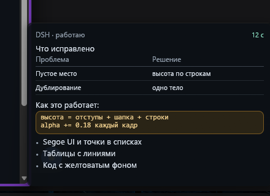

# DSH — вспомогательное окно агента

Плагин для [DeepSeek Harness](https://github.com/deepseek-ai): небольшое
полупрозрачное окно поверх всех окон, которое показывает, что агент делает
прямо сейчас.



## Что показывает

- текущий ответ с оформлением как в чате: заголовки, таблицы, списки,
  блоки кода и инлайн-код плашками;
- строку «Глубокое размышление… N с», пока идёт рассуждение;
- таймер текущего хода;
- прошлый ответ, пока новый ещё не начался.

## Поведение

- правый нижний угол, растёт вверх по мере текста;
- не поднимается выше окна DSH и не заходит на панель задач;
- клики проходят сквозь окно;
- через 30 секунд после завершения работы плавно уезжает вниз;
- закрыть принудительно — `Ctrl+Alt+X`.

## Установка

1. Скачайте `ActivityWindow.exe` из
   [последнего релиза](https://github.com/JxSoll/deepseek-harness-activity-panel/releases/latest).
2. Скачайте папку `plugin/` из репозитория.
3. Положите exe в `plugin/viewer/ActivityWindow.exe`.
4. В DSH: **Плагины → Add plugin** → укажите папку `plugin`.

Готово — окно запустится само и появится, как только агент начнёт отвечать.

**Требования:** Windows 10/11 и DSH Desktop. Rust, .NET и MinGW **не нужны**:
exe собран статически, внешних зависимостей нет.

## Структура

```
plugin/       — плагин DSH (bundle): манифест, патч, index.js, локали, иконка
activity-rs/  — исходник окна: Rust + eframe/egui
```

## Настройка

В `plugin/cordis.patch.yml` профиля можно отключить автозапуск окна:

```yaml
- id: dsh-activity
  name: '@local/dsh-activity-panel'
  config:
    showViewer: false
```

Состояние пишется в `%USERPROFILE%\.dsh\activity\state.json`.

## Лицензия

MIT
